# Vajra Drishti — FPGA-Based Drone Detection and Target Tracking

<p align="center">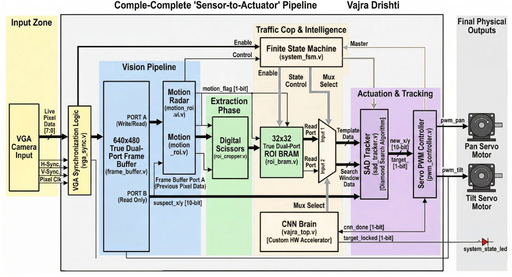</p>

<p align="center"><strong>RTL-first FPGA exploration of motion-guided ROI extraction, CNN-based candidate verification, and SAD-based tracking.</strong></p>

<p align="center">


</p>

> **Status:** The project has progressed beyond the earlier simulation-focused Stage-I version. The fundamental architecture remains the same, while RTL, pipelining, integration, and implementation analysis have evolved. UART hardware demonstration is being prepared. End-to-end hardware operation is **not claimed until it has been demonstrated and documented**.

## Contents
- [Overview](#overview)
- [Architecture](#architecture-and-data-flow)
- [Subsystems](#subsystems)
- [Repository structure](#repository-structure)
- [Implementation reports](#implementation-reports)
- [Simulation and verification](#simulation-and-verification)
- [UART hardware-demo direction](#uart-hardware-demo-direction)
- [Getting started](#getting-started)
- [Documentation](#documentation)
- [Limitations](#limitations-and-responsible-interpretation)

## Overview

**Vajra Drishti** is an FPGA-oriented project exploring a hardware-first pipeline for detecting and tracking a target-like object in grayscale frames. The design combines frame comparison/motion candidate detection, region-of-interest (ROI) extraction, CNN-based candidate verification, and sum-of-absolute-differences (SAD) tracking.

The original Stage-I work established the core processing flow in simulation using a different FPGA target/configuration. The current repository continues the same architectural direction with updated RTL and pipelined modules, reorganized source code, current implementation report images, and preparation for a UART-based hardware demonstration.

### Intended processing flow

1. A host PC prepares grayscale frames.
2. Python sends frame data to the FPGA over a planned USB-to-TTL UART connection.
3. Frame-handling logic stores incoming pixels and identifies a candidate region from frame changes.
4. ROI logic extracts a smaller region for downstream processing.
5. CNN RTL evaluates the ROI against the configured target class.
6. SAD-based logic supports matching/tracking between frames.
7. System control coordinates processing and result outputs.
8. The planned host software receives result data and visualizes it.

This is the intended design flow, not a claim that all stages have already been verified together on physical hardware.

## Architecture and data flow

<p align="center"></p>

```text
Host PC / Python
       |
       | grayscale frame bytes (planned UART interface)
       v
UART receiver -> Frame storage / motion candidate detection
                           |
                           v
                    ROI extraction / buffer
                           |
                           v
                      CNN processing
                           |
                           v
                    Candidate verification
                           |
                           v
                    SAD-based tracking
                           |
                           v
                  System control / results
                    |                 |
                    v                 v
             UART to host       PWM-related logic
```

<p align="center">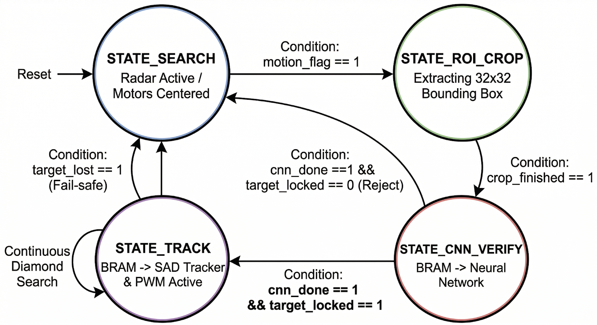</p>

See [Architecture](Docs/architecture.md) for subsystem explanations, data assumptions, and design boundaries.

## Subsystems

### Communication
UART-related RTL is intended to connect the FPGA to a host PC. Bring-up should be staged: first byte echo, then frame protocol, then full-frame processing. A successful echo test only validates basic serial communication.

### Frame handling and ROI
The development configuration has used **640 × 480 grayscale pixels**, equivalent to **307,200 bytes per frame** when each pixel is one byte. Confirm the selected top-level parameters before transmitting data.

<p align="center">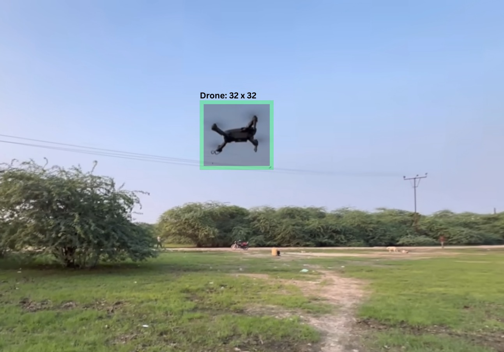</p>

### CNN datapath
The RTL tree includes CNN-related line/window buffering, MAC, convolution, pooling, serialization, and dense-processing blocks. Exact tensor dimensions, numerical formats, weights, thresholds, and latency must be confirmed from RTL and memory files.

<p align="center">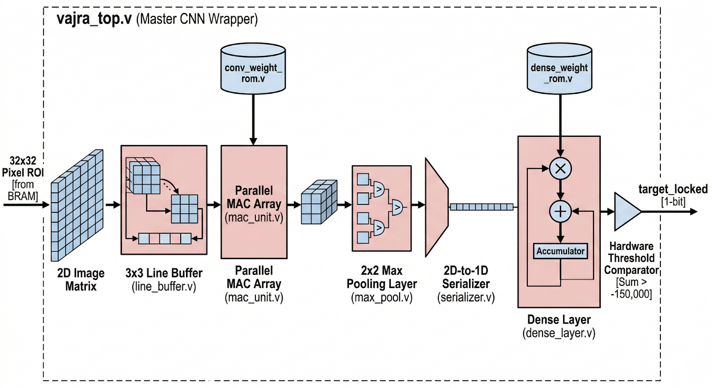</p>
<p align="center">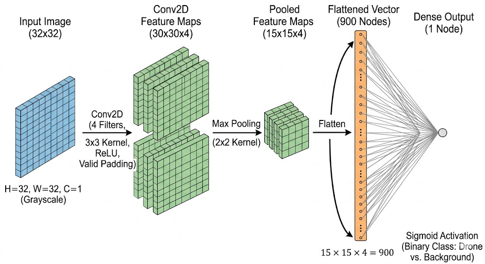</p>

### SAD tracking
<p align="center">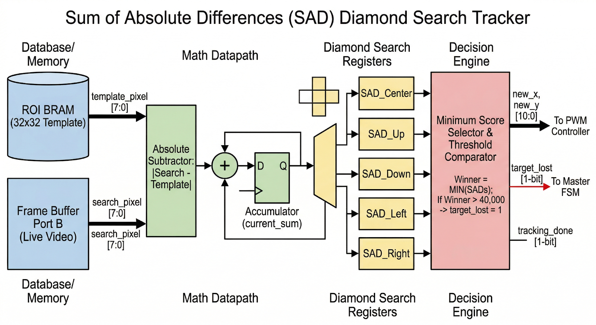</p>

SAD compares candidate patches using absolute pixel differences. Search range, score width, tie-breaking, and coordinate updates are implementation-specific.

### PWM and control
<p align="center">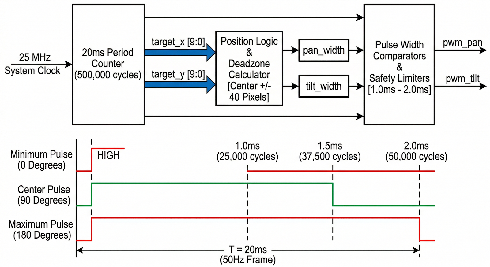</p>

PWM-related RTL exists, but physical actuator operation is not claimed until pins, electrical connections, and behavior have been tested on hardware.

## Repository structure

Based on the repository tree currently shown (not exhaustive):

```text
Vajra_Drishti/
├── README.md
├── Constaints/
│   └── zedboard_vajra.xdc
├── Data/
│   └── raw_frames/
├── Docs/
├── Memory files/
├── RTL/
│   ├── CNN/
│   ├── Communication/
│   ├── Control/
│   ├── Top/
│   ├── Tracking/
│   └── Vision/
├── Simulation/
│   └── Testbenches/
│       ├── Complete System tb/
│       └── Modulewise tb/
├── Software/
├── Reports/
├── images/
│   ├── architecture/
│   ├── implementation/
│   │   └── stage-I_implementation/
│   ├── rtl diagram/
│   │   └── stage-I_rtl/
│   └── simulation/
│       └── stage-I_simulation/
├── legacy/
└── Docs/
    ├── architecture.md
    ├── development_log.md
    ├── hardware_setup.md
    └── verification_status.md
```

The tree is illustrative; the GitHub repository is authoritative. The existing folder is spelled `Constaints`. If you rename it to `Constraints`, update references consistently in a separate change.

## Implementation reports

The current report snapshots are stored in `images/implementation/`.

<table>
<tr>
<td align="center" width="33%">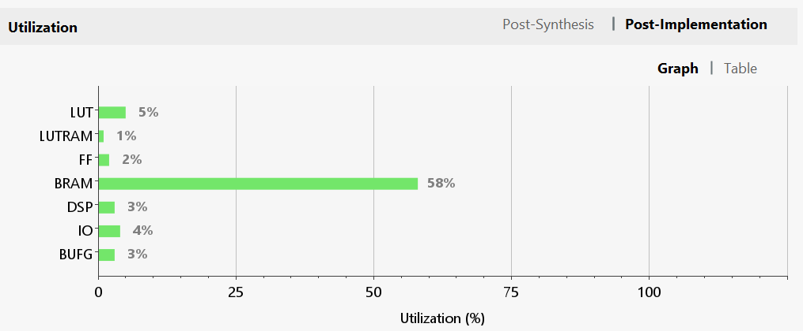<br><strong>Resource utilization</strong></td>
<td align="center" width="33%">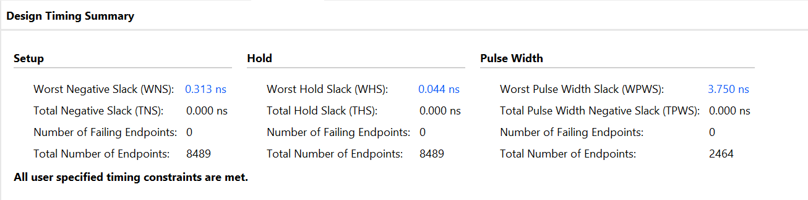<br><strong>Timing analysis</strong></td>
<td align="center" width="33%">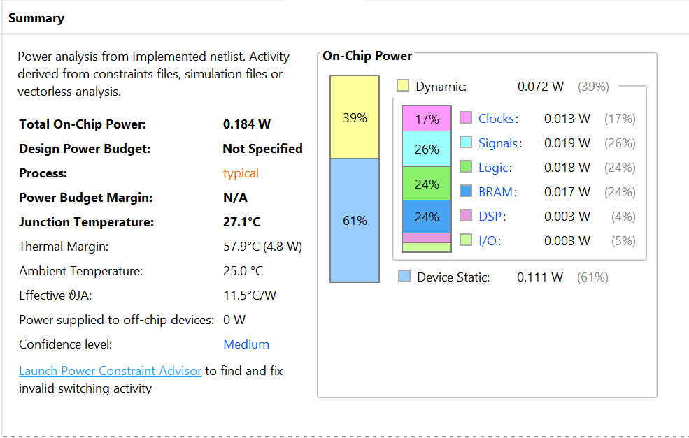<br><strong>Power analysis</strong></td>
</tr>
</table>

These are snapshots, not standalone proof of real-time operation. Document the exact source commit, FPGA part, Vivado version, clock constraints, report stage, and values before making numerical claims. Do not directly compare Stage-I and current results unless target part, constraints, and settings are comparable.

Historical Stage-I reports:
- [Stage-I post-implementation](images/implementation/stage-I_implementation/post_implementation.jpg)
- [Stage-I implementation percentage](images/implementation/stage-I_implementation/post_implementation_percentage.jpg)
- [Stage-I power analysis](images/implementation/stage-I_implementation/power_analysis.jpg)

## Simulation and verification

<p align="center">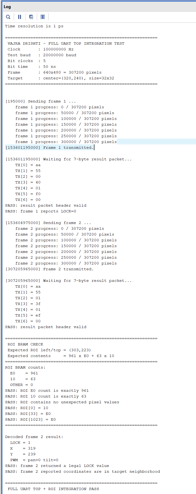</p>

Testbenches are grouped under `Simulation/Testbenches/`, including modulewise and complete-system folders. Stage-I screenshots are retained under `images/simulation/stage-I_simulation/`.

For reproducible evidence, record the testbench, DUT, parameter values, simulator/Vivado version, test scenarios, warnings, pass/fail result, and source commit. A log screenshot is not a substitute for the full transcript. Module-level simulation does not automatically validate the integrated design or physical hardware.

## UART hardware-demo direction

The current plan is to use Python on a host PC, a USB-to-TTL adapter, and the board UART pins. Before sending full frames, confirm that the adapter is 3.3 V TTL (not RS-232), cross TX/RX correctly, share ground, match baud/framing, and validate byte echo. Confirm the exact frame marker and result packet format from RTL before implementing the full host protocol.

See [Hardware Setup](Docs/hardware_setup.md).

## Getting started

1. Obtain the repository and inspect the RTL, memory files, testbenches, and XDC.
2. Read [Architecture](Docs/architecture.md) and [Verification Status](Docs/verification_status.md).
3. Open/create the correct Vivado project for the intended FPGA part.
4. Add required RTL and memory files; select the intended top module.
5. Add the matching XDC and check every port, pin, I/O standard, and clock constraint.
6. Run the appropriate testbench and preserve the full transcript.
7. Run synthesis/implementation and review timing, utilization, and power reports.
8. Validate UART communication separately before attempting full-frame transfer.

Because the design is evolving, do not assume every historical testbench works with every current top module.

## Documentation
- [Architecture](Docs/architecture.md)
- [Development Log](Docs/development_log.md)
- [Hardware Setup](Docs/hardware_setup.md)
- [Verification Status](Docs/verification_status.md)

## Limitations and responsible interpretation

Vajra Drishti is an educational/research engineering project in active development. Results apply only to the specific source revision, parameters, target device, constraints, and scenarios actually tested. This repository does not claim a field-validated, production-ready, or completed autonomous interception system.
